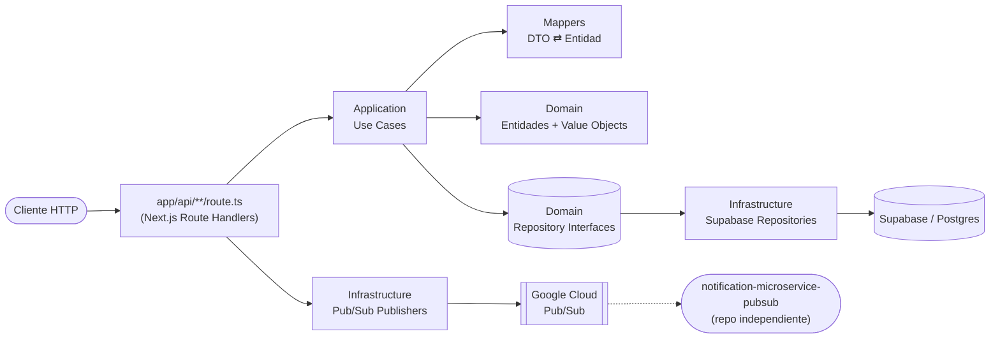
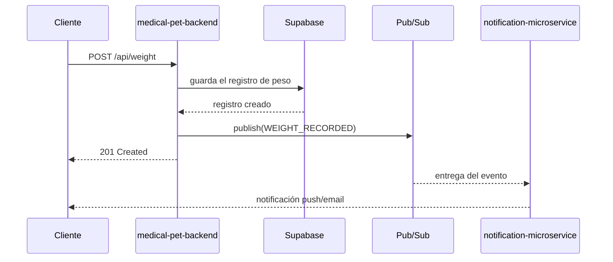

# 🐾 Medical Pet — Backend API

API REST del núcleo clínico de **Medical Pet**: historiales veterinarios, tratamientos, medicación, vacunas, cirugías, laboratorios y control de peso, con arquitectura orientada a eventos hacia un microservicio de notificaciones independiente.


## Contenido

- [Arquitectura](#arquitectura)
- [Módulos de dominio](#módulos-de-dominio)
- [Mensajería asíncrona](#mensajería-asíncrona)
- [Stack](#stack)
- [Puesta en marcha](#puesta-en-marcha)
- [Testing](#testing)
- [Docker](#docker)
- [Despliegue en Cloud Run](#despliegue-en-cloud-run)
- [API](#api)
- [Documentación técnica extendida](#documentación-técnica-extendida)

## Arquitectura

Clean Architecture por capas, aplicada de forma consistente en cada módulo de dominio (visitas, tratamientos, medicación, vacunas, cirugías, laboratorios, peso):



La capa de dominio no conoce HTTP, Supabase ni Pub/Sub: los route handlers son el único punto que orquesta caso de uso + publicación de evento, y esa publicación **nunca** bloquea la respuesta HTTP (un fallo de Pub/Sub se loguea, no se propaga).

## Módulos de dominio

| Módulo | Recurso | Eventos publicados |
|---|---|---|
| 🏥 Visitas veterinarias | `/api/visits` | `VISIT_SCHEDULED`, `VISIT_COMPLETED`, recordatorios |
| 💊 Tratamientos | `/api/treatments` | `TREATMENT_STARTED`, `TREATMENT_UPDATED`, `TREATMENT_COMPLETED` |
| 💉 Medicación | `/api/medications` | `MEDICATION_ADDED`, `MEDICATION_PRESCRIBED`, `MEDICATION_ADMINISTERED`, `MEDICATION_UPDATED` |
| 🩹 Cirugías | `/api/surgery` | `SURGERY_SCHEDULED`, `SURGERY_COMPLETED` |
| 💉 Vacunas | `/api/vaccines` | `VACCINE_APPLIED`, `VACCINE_DUE_REMINDER`, `VACCINE_OVERDUE_REMINDER` |
| 🔬 Laboratorios | `/api/lab` | `LAB_TEST_CREATED`, `LAB_TEST_RESULT_UPDATED`, `LAB_TEST_IS_NORMAL_CHECKED` |
| ⚖️ Control de peso | `/api/weight` | `WEIGHT_RECORDED`, `WEIGHT_UPDATED`, `WEIGHT_ALERT` |
| ⏰ Recordatorios | `/api/cron/*` | Disparadores para Cloud Scheduler |

Cada módulo sigue el mismo patrón: **entidad de dominio** con invariantes propias, **value objects** para conceptos con validación (`Dosage`, `Frequency`, `Temperature`, `Weight`), **casos de uso** con una responsabilidad cada uno, y un **repositorio Supabase** que implementa el puerto de dominio.

## Mensajería asíncrona

Cada acción relevante del dominio publica un evento a un topic de Google Cloud Pub/Sub. Un microservicio independiente (`notification-microservice-pubsub`) se suscribe y genera las notificaciones al usuario:



7 dominios × ~3 eventos cada uno, todos tipados extremo a extremo en `PubSubEventMap`. El detalle completo de topics, suscripciones y payloads está en [`AGENTS.md`](./AGENTS.md#7-mensajería--google-cloud-pubsub).

## Stack

| | |
|---|---|
| **Framework** | Next.js 16 (App Router, Turbopack) — usado como servidor de API, sin frontend |
| **Lenguaje** | TypeScript 5 (`strict`) |
| **Base de datos** | Supabase (Postgres) |
| **Mensajería** | Google Cloud Pub/Sub |
| **Testing** | Jest + ts-jest |
| **Contenedor** | Docker (build multi-stage, salida `standalone`) |
| **Despliegue** | Google Cloud Run |

## Puesta en marcha

### Requisitos

- Node.js 22+
- Un proyecto de Supabase (URL + anon key)
- Un proyecto de Google Cloud con Pub/Sub habilitado y `gcloud auth application-default login` configurado localmente

### Instalación

```bash
npm install
```

### Variables de entorno

Crea un `.env.local` en la raíz:

```bash
NEXT_PUBLIC_SUPABASE_URL=https://tu-proyecto.supabase.co
NEXT_PUBLIC_SUPABASE_ANON_KEY=tu-anon-key
GOOGLE_CLOUD_PROJECT=tu-project-id
```

### Desarrollo

```bash
npm run dev
```

Servidor disponible en [http://localhost:3000](http://localhost:3000).

## Testing

```bash
npm test              # suite completa
npm run test:watch    # modo watch
npm run test:coverage # con cobertura
```

Tests unitarios de casos de uso, entidades, value objects y repositorios (mockeando el query builder de Supabase), organizados junto al código que cubren (`__test__/`).

## Docker

```bash
docker build \
  --build-arg NEXT_PUBLIC_SUPABASE_URL=$NEXT_PUBLIC_SUPABASE_URL \
  --build-arg NEXT_PUBLIC_SUPABASE_ANON_KEY=$NEXT_PUBLIC_SUPABASE_ANON_KEY \
  -t medical-pet-microservice .

docker run -d --name pets-app -p 3000:3000 \
  --env-file .env.local \
  -e GOOGLE_APPLICATION_CREDENTIALS=/gcp/adc.json \
  -v ~/.config/gcloud/application_default_credentials.json:/gcp/adc.json:ro \
  medical-pet-microservice
```

> Las credenciales de Pub/Sub son de **runtime**, no de build: `docker build` no las necesita, `docker run` sí (monta tu ADC o un service account key).

## Despliegue en Cloud Run

```bash
gcloud run deploy medical-pet-backend \
  --region us-central1 \
  --image REGION-docker.pkg.dev/PROJECT_ID/repo/medical-pet-backend \
  --service-account=medical-pet-backend@PROJECT_ID.iam.gserviceaccount.com \
  --set-env-vars=GOOGLE_CLOUD_PROJECT=PROJECT_ID,NEXT_PUBLIC_SUPABASE_URL=...,NEXT_PUBLIC_SUPABASE_ANON_KEY=... \
  --allow-unauthenticated
```

El service account necesita `roles/pubsub.publisher` sobre el proyecto (o los topics específicos):

```bash
gcloud projects add-iam-policy-binding PROJECT_ID \
  --member="serviceAccount:medical-pet-backend@PROJECT_ID.iam.gserviceaccount.com" \
  --role="roles/pubsub.publisher"
```

## API

Resumen de recursos (ver [`AGENTS.md`](./AGENTS.md#5-mapa-de-la-api) para el detalle método por método):

| Recurso | Endpoints |
|---|---|
| `/api/visits` | listar por rango/pet, crear, obtener, actualizar |
| `/api/treatments` | crear, obtener, actualizar, agregar medicación, estado activo |
| `/api/medications/[id]` | obtener, actualizar dosis/frecuencia |
| `/api/surgery` | CRUD completo, filtros por pet/visita |
| `/api/vaccines` | listar, aplicar, actualizar, vencimiento |
| `/api/lab` | crear, listar por visita, actualizar resultado |
| `/api/weight` | crear, listar, último registro por pet, actualizar |
| `/api/cron/*` | recordatorios de vacunas y visitas |

## Documentación técnica extendida

[`AGENTS.md`](./AGENTS.md) cubre, con más detalle del que cabe en este README: estructura de carpetas completa, convenciones y deuda técnica conocida, catálogo íntegro de eventos Pub/Sub, variables de entorno, y la causa exacta (con solución) de los errores más comunes al desplegar (credenciales de Pub/Sub en Docker/Cloud Run, foreign keys de Supabase, tipado de mocks en Jest).

---

Parte del ecosistema **Medical Pet**, junto al microservicio `notification-microservice-pubsub` (repo independiente) encargado de las notificaciones.
